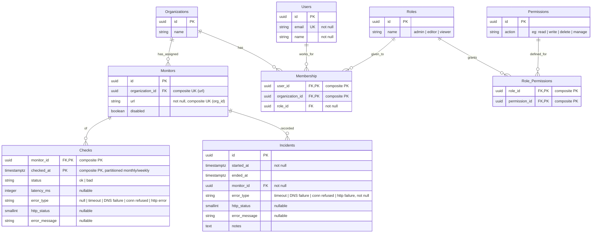

# Dashboard_app

## Outline
- Compute for the API and workers separately. They scale differently.
- AWS RDS as a managed database.
- Static hosting for react build (CDN).
- Networking: what's public and what's private.
- Monitoring of our own system: logs, metrics and alarms.

## Scope
- **MVP:** auth, monitoring app, scheduled checks, results table, basic dashboard, AWS deployment.
- **v2:** rollups and percentiles, SSRF, alerting the user on indcident with state machine.
- **Stretch:** multi-region probes, public status page, partitioning with retention policies, AI agent.

## Progress
1. [x] Requirements
2. [ ] Data model and ingestion
3. [ ] API and auth
4. [ ] Scheduler and worker
5. [ ] Dashboard frontend
6. [ ] AWS architecture
7. [ ] Monitoring our own system
8. [ ] Load testing and scaling write-up

## Mental notes:
- The user signs up and puts some url in the *monitor* which checks the http expecting status 200 every 60 seconds with 10 second timeout.
- CRUD but must be multi-tenant, user A must never see user B's monitors.
- A scheduler is required to decide when a check is due and wake up a worker to actually make the request. It's job is to wake up independently, find due work and schedule it, without two workers making the same check and without losing checks when a worker crashes.
- A worker which actually makes the http request to the url we want to monitor, measures how long it takes and records the result (error type, latency, status code). Some things to keep in mind:
    * What happens if our internet blips?
    * What actually is a failure? A timeout? A 500? A DNS failure? A successful but slow request?
- Every check makes a row, 1000 checks every minute is 1.4 million new rows in the database per day, 43 million per month. Need to figure out how to keep it efficient and probably shave off old data, include indexes instead of one massive table and make other optimizations.
- The dashboard shows uptime, latency % and a list of incidents, when an alert happens, the user gets an email.
- We will be using percentile instead of average (99 checks take 100ms, one check is 10s, average becomes 199ms). We can instead use p95 or p99 (we can use percentile_cont or percentile_disc in postgres).
    * sample query: 
        ```sql
        SELECT percentile_cont(0.95) WITHIN GROUP 
        (ORDER BY latency_ms) AS p95
        FROM check_results
        WHERE monitor_id = 42;
        ```
        here `WITHIN GROUP (ORDER BY latency_ms)` is an ordered-set average, which means that the functions sorts first to find the 95th percentile.
    * We cannot average the p95 of 2 hours, it is not the p95 of 2 hours (no aggregation of values into hourly summaries). The solutions are histogram buckets or t-digest (approximate structure). Know the trade-offs.
- Don't send the email on the first notice of failure, the best practice is to wait for 3 consequtive failures before sending the mail, also we don't want to send mails for consequtive checks either. An incident looks like a state machine `UP -> DOWN -> RECOVERING -> UP`
- Since we're looking to implement RBAC, our "user A cannot see user B's monitor" becomes "members of a *team* share monitors, and what each *member* does depends on their *roles*". We have to look into moving from users to organizations since a user can belong to multiple organizations. We need to think about what roles we want (admin, viewer, owner, member, etc) and what permissions they should have.
- The AI agent can act as an incident investigator which deduces what could've happened by reading from logs and history.
    * Changes how incidents are stored in db, from simple records to first class citizen and also storing details of the error.
    * The agent acts on behalf of the user, hence it is also subject to obeying the same RBAC rules.
- We can implement a chart at the top of the page which shows the latency fluctuation over time as the curve.
- Sort batches by worker_id before inserting. Every 60 seconds, sort your array of worker records by worker_id in your backend code before running a multi-row INSERT. This turns random UUID index lookups into an orderly, sequential pass through the B-tree.
- Keep created_at in your WHERE clause. Always include a time range filter (e.g., `AND created_at >= now() - interval '7 days'`) when querying for a chart. This enables partition pruning, allowing PostgreSQL to completely ignore older partitions and only touch the relevant week or month.

## Things to watch out for
- If two workers run at the same time, how does each one claim a different work without collision.
- If we fire a thundering herd of 1000 requests every :00 of the clock, the system will add a jitter (small random offset per monitor)
- SSRF: server-side request forgery is an attack where user uploads a malicious url like `http://169.254.169.254/latest/meta-data/` which fetches the internal meta-data. The posted urls need to be validated first, using a technique called DNS rebinding which validates resolved IPs against private ranges, and using the AWS IMDSv2 setting.
- Once we start getting into nginx configuration, we need to watch out for the fact that in express, req.ip becomes the proxy's ip, not the user's unless we do `app.set("trust proxy", 1)`. This means trust exactly 1 proxy hop, but once it's true or too high, a client can forge `X-forwarded-for` and spoof their IP.
- In the chart, just keep in mind that a month has about 43,000 points per monitor and no chart shows 43,000 points.
```
IDOR (Insecure Direct Object Reference) is a web application security flaw, not a built-in database management system (DBMS) bug. It occurs when an application uses user-supplied input—such as a primary key or record ID from a database—to directly fetch data without checking if the current user is allowed to see it.

How IDOR Relates to a DBMS

While the vulnerability lives in the application's code, it directly exposes your database records to unauthorized users.
• Predictable Database Keys: Many DBMS tables use auto-incrementing integers (101, 102, 103) as primary keys. Attackers can easily guess adjacent IDs in a URL or API request to pull other users' rows from the database.
• Missing Ownership Checks: The application runs a query like SELECT * FROM invoices WHERE id = ? using the ID provided by the user. Because the query does not verify that the user_id column matches the logged-in user, the database faithfully returns private data.
• Data Tampering and Deletion: Beyond reading records, attackers can manipulate IDs in UPDATE or DELETE requests to modify or wipe out another user's database entries.

How to Prevent IDOR

Securing against IDOR requires combining better database design with strict application-level checks.
• Enforce Server-Side Authorization: Always validate that the authenticated user owns or has permission to access the requested record before executing the database query.
• Use Non-Sequential Identifiers: Replace predictable auto-incrementing IDs with UUIDs (Universally Unique Identifiers) or random hashes for public-facing URLs and APIs.
• Implement Row-Level Security (RLS): Modern databases like PostgreSQL and SQL Server allow you to define access policies directly on table rows. This ensures the DBMS itself blocks queries from returning rows that do not belong to the active user session.
• Use Indirect Reference Maps: Map public, session-specific tokens to actual database primary keys on the server side so internal database IDs are never exposed to the client.
```
- By default, PostgreSQL allocates lock space assuming a small number of tables per transaction (default 64). When pg_dump, VACUUM, or an unpruned query touches 1,000+ partitions at once, it can exhaust shared lock memory and throw an out of shared memory error. Bump max_locks_per_transaction to 256 or 512 in postgresql.conf
- Query child partitions directly for heavy background jobs. If you have an analytics job or worker writing to the current partition, writing directly to worker_performance_2026_w46 instead of the parent table bypasses partition routing overhead completely.
- Put PgBouncer in front of PostgreSQL. Every PostgreSQL backend process caches partition metadata (relcache) in its own private RAM. If 200 app connections touch 1,500 partitions, that metadata multiplies 200 times and can trigger Out-Of-Memory (OOM) crashes. Use PgBouncer in transaction pooling mode to keep actual PostgreSQL backend connections low (e.g., 20 to 40).
- URL normalization. https://example.com, https://example.com/, HTTPS://Example.com, and https://example.com:443/ are the same target but different strings. Normalize before insert (lowercase scheme and host, strip default ports, handle trailing slash consistently), or the constraint will be easy to bypass.

## Page Designs
- [ ] Overview page of a single URL:
    

## ER Diagram
- [ ] Table to be viewed on page
```mermaid
erDiagram
    Display {
        uuid id PK
        timestamptz started_at "not null"
        timestamptz ended_at "not null"
        string status "ok | bad | NA"
        integer down_time "calculated hourly/daily/monthly"
        integer n95_n99_latency "nullable"
        integer number_of_incidents "min 0"
        string detail_summary "combination of error details"
        numeric(5,2) up_time_percentage "(total checks-error checks)*100/total checks"
    }
```
- [ ] Database tables
